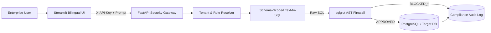

# 🛡️ GuardSQL Enterprise — AI-to-SQL Security & Governance Gateway


**GuardSQL Enterprise** is a production-ready, multi-tenant **Zero-Trust AI-to-SQL Firewall** designed for enterprises deploying LLM-powered analytics. Instead of letting AI agents run raw generated SQL against production databases, GuardSQL parses every query into an **Abstract Syntax Tree (AST)** and enforces strict **Column-Level RBAC, Hallucination Detection, Destructive Command Blocking, and Query Cost Guardrails** with full compliance audit logging.

---

## 🏗️ System Architecture



---

## 🔒 5-Layer Deterministic Security Engine

| Layer | Protection Mechanism | Blocked Status | Example Threat Mitigated |
| :--- | :--- | :--- | :--- |
| **1. Syntax & Injection** | Single-statement AST verification | `BLOCKED_SYNTAX` | `SELECT 1; DROP TABLE users;--` (Stacked queries) |
| **2. DDL / DML Guard** | Deep AST node traversal for write ops | `BLOCKED_DDL_DML` | `DROP`, `DELETE`, `UPDATE`, `ALTER`, `GRANT` |
| **3. Hallucination Check** | Strict allowlist verification against tenant schema | `BLOCKED_RBAC` | AI inventing non-existent tables or columns |
| **4. Column-Level RBAC** | Alias-aware column & `SELECT *` enforcement | `BLOCKED_RBAC` | `Finance_Analyst` querying `hr_salaries.salary` |
| **5. Cost Guardrails** | Heuristic join/subquery/full-scan scoring | `BLOCKED_COST` | Unbounded `CROSS JOIN` crashing production DB |

---

## 🚀 Quick Start (Local Development)

### 1. Start the FastAPI Security Gateway
```bash
pip install -r requirements.txt
uvicorn app.main:app --reload --port 8000
```

### 2. Launch the Interactive Demo Dashboard (TR / EN)
```bash
streamlit run frontend/streamlit_app.py --server.port 8501
```

### 3. Run Automated Linter & End-to-End Security Tests
```bash
ruff check .
pytest -v
```

---

## 🐳 Docker Deployment

```bash
docker-compose up --build
```
- **API Documentation (Swagger UI):** `http://localhost:8000/docs`
- **Interactive Security Dashboard:** `http://localhost:8501`

---

## 🔌 API Usage Example

```bash
# 1. Seed Demo Enterprise Tenant (Acme Finans A.Ş.)
curl -X POST http://localhost:8000/api/v1/tenants/seed-demo

# 2. Ask Natural Language Query with Tenant API Key
curl -X POST http://localhost:8000/api/v1/query/ask \
  -H "X-API-Key: gsql_demo_secret_key_2026" \
  -H "Content-Type: application/json" \
  -d '{
    "user_id": "<ANALYST_USER_ID>",
    "prompt": "show all employee salaries",
    "execute_query": true,
    "language": "en"
  }'
```

---

## 📄 License
MIT License — Built for enterprise AI governance and secure data engineering.