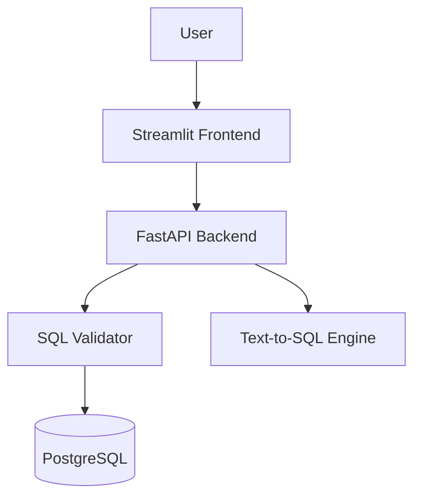

# GuardSQL Enterprise

Enterprise-grade Multi-Tenant Text-to-SQL security and auditing platform.

## Architecture


## Quick Start
```bash
docker-compose up --build
```

## Demo
[Watch the demo video]
