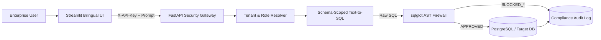

# 🛡️ GuardSQL Enterprise — AI-to-SQL Security & Governance Gateway

[](https://github.com)


> 🌐 **Language / Dil:** [English](#-english-documentation) | [Türkçe](#-türkçe-dokümantasyon)  
> 🎥 **Live Walkthrough:** [Watch the 65-Second Architecture & Security Demo on Loom](https://www.loom.com/share/06aae7cdc38049fd9162e7c5acf42051)

---

## 🇬🇧 English Documentation

**GuardSQL Enterprise** is a production-ready, multi-tenant **Zero-Trust AI-to-SQL Firewall** built for organizations deploying LLM-powered analytics. Instead of letting AI agents run raw generated SQL directly against production databases, GuardSQL parses every query into an **Abstract Syntax Tree (AST)** and enforces strict **Column-Level RBAC, Hallucination Detection, Destructive Command Blocking, and Query Cost Guardrails** with full compliance audit logging.

### 🏗️ System Architecture



### 🔒 5-Layer Deterministic Security Engine

| Layer | Protection Mechanism | Blocked Status | Example Threat Mitigated |
| :--- | :--- | :--- | :--- |
| **1. Syntax & Injection** | Single-statement AST verification | `BLOCKED_SYNTAX` | `SELECT 1; DROP TABLE users;--` (Stacked queries) |
| **2. DDL / DML Guard** | Deep AST node traversal for write ops | `BLOCKED_DDL_DML` | `DROP`, `DELETE`, `UPDATE`, `ALTER`, `GRANT` |
| **3. Hallucination Check** | Strict allowlist verification against tenant schema | `BLOCKED_RBAC` | AI inventing non-existent tables or columns |
| **4. Column-Level RBAC** | Alias-aware column & `SELECT *` enforcement | `BLOCKED_RBAC` | `Finance_Analyst` querying `hr_salaries.salary` |
| **5. Cost Guardrails** | Heuristic join/subquery/full-scan scoring | `BLOCKED_COST` | Unbounded `CROSS JOIN` crashing production DB |

### 🚀 Quick Start (Local Development)

#### Option A: One-Click Launcher (Recommended)
* **Windows (PowerShell):**
  ```powershell
  pip install -r requirements.txt
  .\start.ps1
  ```
* **Linux / macOS:**
  ```bash
  pip install -r requirements.txt
  chmod +x start.sh && ./start.sh
  ```

#### Option B: Manual Two-Terminal Setup
1. **Start the FastAPI Security Gateway:**
   ```bash
   python -m uvicorn app.main:app --reload --port 8000
   ```
2. **Launch the Interactive Demo Dashboard (TR / EN):**
   ```bash
   python -m streamlit run frontend/streamlit_app.py --server.port 8501
   ```
3. **Run Automated Linter & End-to-End Security Tests:**
   ```bash
   python -m ruff check .
   python -m pytest -v
   ```

### 🐳 Docker Deployment

```bash
docker-compose up --build
```
* **API Documentation (Swagger UI):** `http://localhost:8000/docs`
* **Interactive Security Dashboard:** `http://localhost:8501`

### 🔌 API Usage Example

```bash
# 1. Seed Demo Enterprise Tenant (Acme Finans A.Ş.)
curl -X POST http://localhost:8000/api/v1/tenants/seed-demo

# 2. Ask Natural Language Query with Tenant API Key
curl -X POST http://localhost:8000/api/v1/query/ask \
  -H "X-API-Key: gsql_demo_secret_key_2026" \
  -H "Content-Type: application/json" \
  -d '{
    "user_id": "<ANALYST_USER_ID>",
    "prompt": "show all employee salaries",
    "execute_query": true,
    "language": "en"
  }'
```

---

## 🇹🇷 Türkçe Dokümantasyon

**GuardSQL Enterprise**, yapay zeka destekli veri analitiği kullanan kurumlar için geliştirilmiş, çok kiracılı (**Multi-Tenant**) ve sıfır güven (**Zero-Trust**) mimarisine sahip kurumsal bir **AI-to-SQL Güvenlik Duvarıdır**. Yapay zeka modellerinin ürettiği ham SQL sorgularının doğrudan canlı veritabanında çalıştırılmasına izin vermek yerine; her sorguyu **Soyut Sözdizimi Ağacına (AST)** ayırır, sıkı **Sütun Seviyesi Yetki Kontrolü (RBAC), Halüsinasyon Tespiti, Yıkıcı Komut Engelleme ve Sorgu Maliyet Kalkanı** kurallarından geçirerek tüm işlemleri denetim günlüğüne kaydeder.

### 🔒 5 Katmanlı Deterministik Güvenlik Motoru

| Katman | Koruma Mekanizması | Engel Durumu | Önlenen Risk / Saldırı Örneği |
| :--- | :--- | :--- | :--- |
| **1. Sözdizimi & Enjeksiyon** | Tek sorgu kuralı AST doğrulaması | `BLOCKED_SYNTAX` | `SELECT 1; DROP TABLE users;--` (Çoklu enjeksiyon) |
| **2. DDL / DML Koruması** | Yazma/silme komutları için derin AST taraması | `BLOCKED_DDL_DML` | `DROP`, `DELETE`, `UPDATE`, `ALTER`, `GRANT` |
| **3. Halüsinasyon Kontrolü** | Kiracı şemasına karşı sıkı beyaz liste (allowlist) kontrolü | `BLOCKED_RBAC` | Yapay zekanın var olmayan tablo veya sütun uydurması |
| **4. Sütun Seviyesi RBAC** | Tablo takma adı (alias) duyarlı sütun ve `SELECT *` yasağı | `BLOCKED_RBAC` | `Finance_Analyst` rolünün `hr_salaries.salary` sorgulaması |
| **5. Maliyet Kalkanı** | Join, alt sorgu ve tam tablo taraması skorlaması | `BLOCKED_COST` | Veritabanını kilitleyen sınırsız `CROSS JOIN` sorguları |

### 🚀 Hızlı Kurulum (Yerel Geliştirme)

#### Seçenek A: Tek Komutla Başlatma (Önerilen)
* **Windows (PowerShell):**
  ```powershell
  pip install -r requirements.txt
  .\start.ps1
  ```
* **Linux / macOS:**
  ```bash
  pip install -r requirements.txt
  chmod +x start.sh && ./start.sh
  ```

#### Seçenek B: İki Terminalli Manuel Kurulum
1. **FastAPI Güvenlik Ağ Geçidini Başlatın:**
   ```bash
   python -m uvicorn app.main:app --reload --port 8000
   ```
2. **Çift Dilli Etkileşimli Demo Panelini Açın (TR / EN):**
   ```bash
   python -m streamlit run frontend/streamlit_app.py --server.port 8501
   ```
3. **Kod Kalitesi (Linter) ve Uçtan Uca Güvenlik Testlerini Çalıştırın:**
   ```bash
   python -m ruff check .
   python -m pytest -v
   ```

### 🐳 Docker ile Kurulum

```bash
docker-compose up --build
```
* **API Dokümantasyonu (Swagger UI):** `http://localhost:8000/docs`
* **Etkileşimli Güvenlik Paneli:** `http://localhost:8501`

---

## 📄 License / Lisans
MIT License — Built for enterprise AI governance and secure data engineering.
